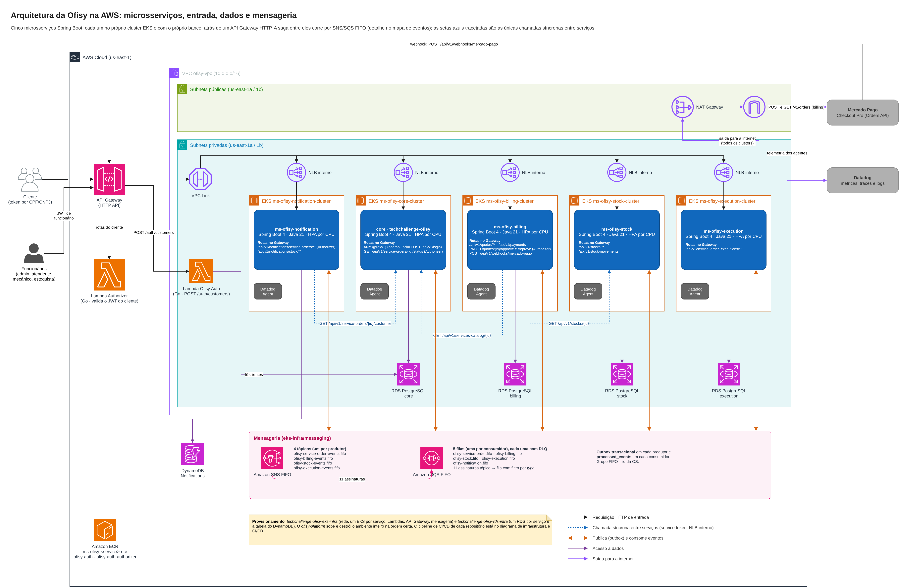
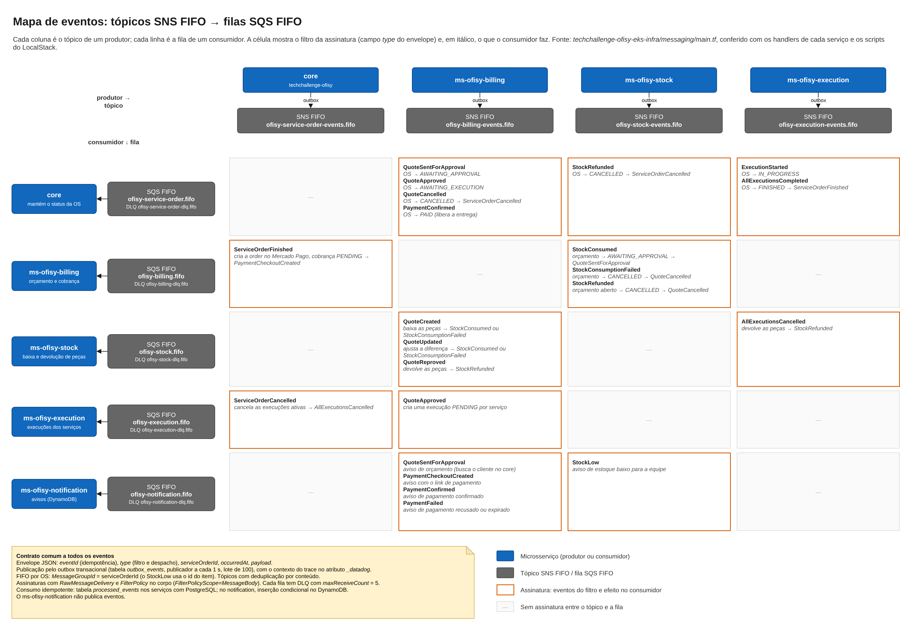
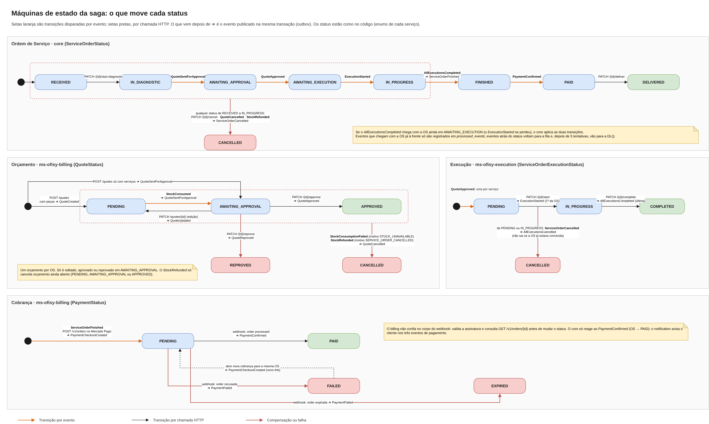

# Arquitetura - Ofisy

Visão da arquitetura depois da divisão em microsserviços ([ADR-0010](adr/0010-dividir-a-aplicacao-em-microsservicos-por-bounded-context.md)), com a saga coordenada por coreografia ([ADR-0012](adr/0012-coordenar-a-saga-por-coreografia.md)) sobre SNS e SQS ([ADR-0011](adr/0011-utilizar-sns-e-sqs-como-mensageria.md)), e com o fluxo da saga como implementado ([ADR-0015](adr/0015-ajustar-a-saga-da-os-ao-fluxo-implementado.md)).

Os desenhos vão do mais geral ao mais detalhado:

1. [Arquitetura na AWS](#1-arquitetura-na-aws): onde cada peça roda e como elas se falam.
2. [Mapa de eventos](#2-mapa-de-eventos): quais tópicos chegam em quais filas e com quais filtros.
3. [Saga](#3-saga): o fluxo da OS ponta a ponta e as compensações, detalhados em [SEQUENCE-DIAGRAM.md](SEQUENCE-DIAGRAM.md).
4. [Máquinas de estado](#4-máquinas-de-estado): o que move o status da OS, do orçamento, da execução e da cobrança.

O diagrama de componentes do core está em [COMPONENT-DIAGRAM.md](COMPONENT-DIAGRAM.md). A infraestrutura e o CI/CD estão em [INFRA-CICD-DIAGRAM.md](INFRA-CICD-DIAGRAM.md).

## 1. Arquitetura na AWS

| Componente | Repositório | O que faz |
|---|---|---|
| API Gateway (HTTP API) | `techchallenge-ofisy-eks-infra/api-gateway` | Entrada pública. Encaminha cada rota ao NLB interno do serviço pelo VPC Link |
| Lambda Ofisy Auth | `techchallenge-ofisy-auth` | `POST /auth/customers`: autentica o cliente por CPF/CNPJ no RDS do core e devolve o JWT |
| Lambda Authorizer | `techchallenge-ofisy-auth` | Valida o JWT do cliente nas rotas protegidas e repassa o `customerId` no header `X-Customer-Id` |
| core | `techchallenge-ofisy` | OS, clientes, veículos, catálogo de serviços e usuários. Emite o JWT de funcionário (`POST /api/v1/login`) |
| ms-ofisy-billing | `ms-ofisy-billing` | Orçamento e cobrança, integrado ao Mercado Pago |
| ms-ofisy-stock | `ms-ofisy-stock` | Peças, baixa e devolução por OS |
| ms-ofisy-execution | `ms-ofisy-execution` | Execução de cada serviço do orçamento aprovado |
| ms-ofisy-notification | `ms-ofisy-notification` | Avisos ao cliente e à equipe, gravados no DynamoDB |
| RDS PostgreSQL (4) | `techchallenge-ofisy-rds-infra` | Um banco por serviço: core, billing, stock e execution |
| DynamoDB `Notifications` | `techchallenge-ofisy-rds-infra/notification` | Avisos do notification |
| SNS e SQS FIFO | `techchallenge-ofisy-eks-infra/messaging` | 4 tópicos, 5 filas com DLQ e 11 assinaturas |
| Ambiente completo | `ofisy-platform` | Sobe e destrói tudo na ordem certa |

Cada serviço roda no próprio cluster EKS (`ms-ofisy-<service>-cluster`), com HPA por CPU e um Datadog Agent instalado por Helm. Os NLBs são internos: só o VPC Link e os outros serviços dentro da VPC os alcançam.

As únicas chamadas síncronas entre serviços usam um token de serviço:

| Origem | Destino | Chamada | Para quê |
|---|---|---|---|
| billing | core | `GET /api/v1/services-catalog/{id}` | Nome e preço do serviço ao montar o orçamento |
| billing | stock | `GET /api/v1/stocks/{id}` | Nome e preço da peça ao montar o orçamento |
| notification | core | `GET /api/v1/service-orders/{id}/customer` | Dono da OS para o aviso de orçamento |
| billing | Mercado Pago | `POST /v1/orders` e `GET /v1/orders/{id}` | Criar a cobrança e conferir o status depois do webhook |

## 2. Mapa de eventos

Cada produtor publica no próprio tópico pelo outbox transacional. Cada consumidor lê da própria fila, que só recebe os tipos do filtro da assinatura. O grupo FIFO é o id da OS, então os eventos de uma mesma OS chegam em ordem dentro de cada fila. O `StockLow` é a exceção: não pertence a uma OS e é agrupado pelo id do item. O envelope, o outbox e o listener do core estão em [MESSAGING.md](MESSAGING.md).

## 3. Saga

O fluxo ponta a ponta, da autenticação à entrega do veículo, e os caminhos de compensação estão em [SEQUENCE-DIAGRAM.md](SEQUENCE-DIAGRAM.md).

## 4. Máquinas de estado

