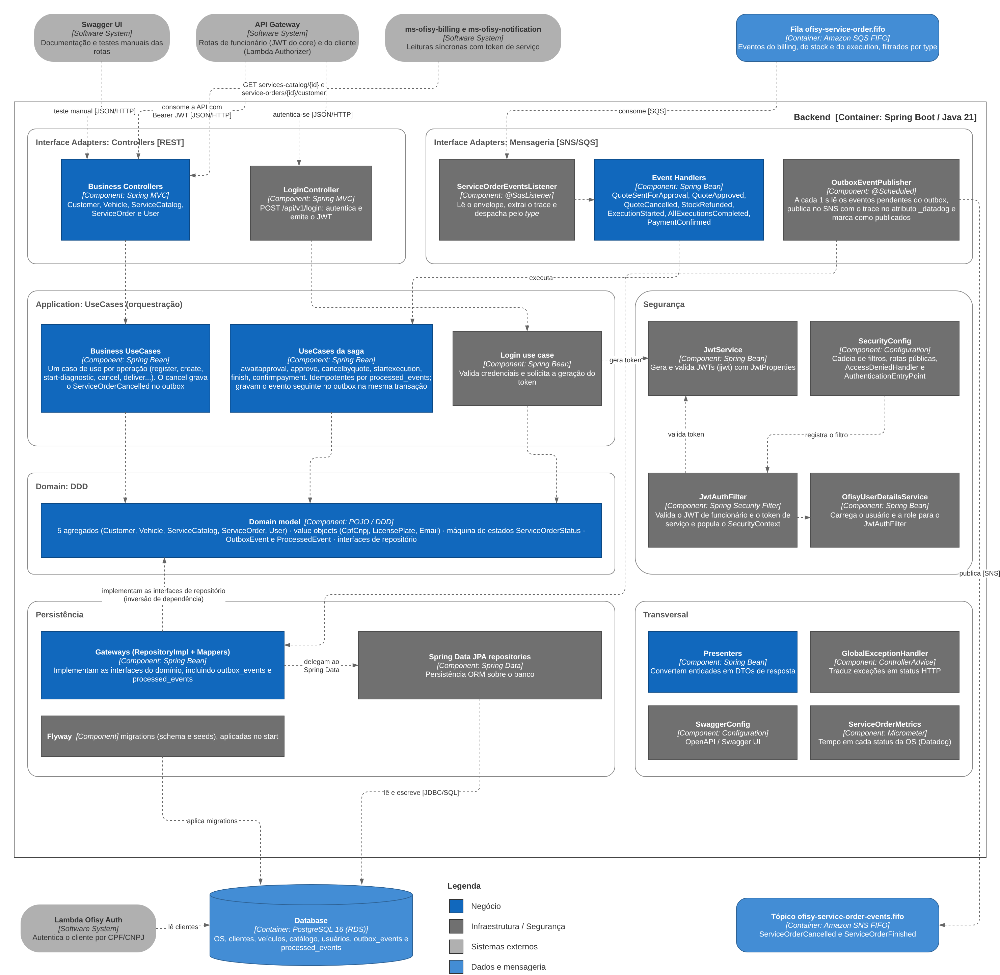

# Diagrama de Componentes - Ofisy

Diagrama de componentes do **container Backend** do core (`techchallenge-ofisy`, Spring Boot / Java 21), usando Clean Architecture.

Depois da divisão em microsserviços, o core ficou com 5 agregados de negócio: Customer, Vehicle, ServiceCatalog, ServiceOrder e User. Orçamento, estoque, execução e notificação estão nos próprios serviços (ver [ARCHITECTURE.md](ARCHITECTURE.md)). Os 5 agregados seguem o mesmo caminho de camadas `Controller → Use Case → Gateway`, então aparecem agrupados em um bloco só.

Três mecanismos têm caixa própria:

- **Autenticação**: o `JwtAuthFilter` aceita o JWT de funcionário emitido pelo `LoginController` e o token de serviço que o billing e o notification usam nas leituras síncronas.
- **Consumo de eventos**: o `ServiceOrderEventsListener` lê a fila `ofisy-service-order.fifo` e despacha cada evento pelo `type` para um handler. Os use cases da saga são idempotentes (`processed_events`) e movem o status da OS.
- **Publicação de eventos**: os use cases gravam o evento seguinte no outbox, na mesma transação da mudança de status, e o `OutboxEventPublisher` publica no tópico `ofisy-service-order-events.fifo`.

