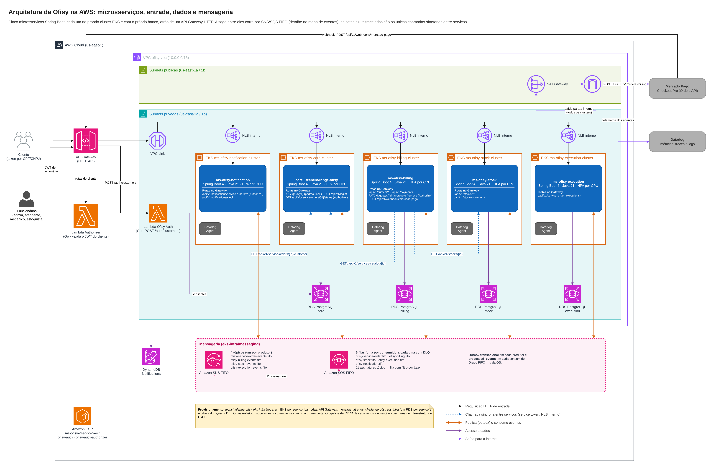
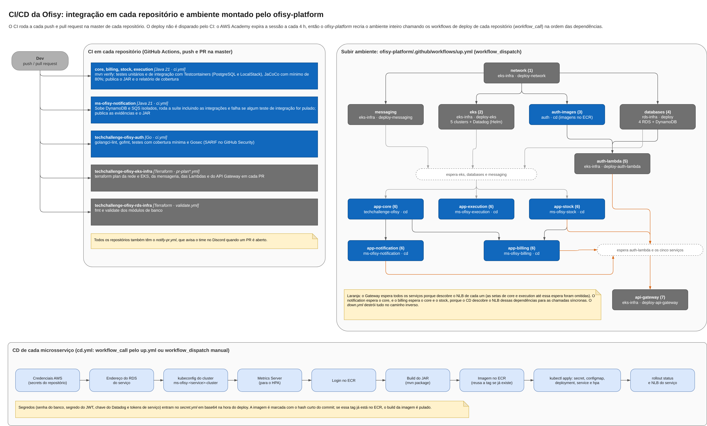

# Diagrama de Infraestrutura e CI/CD - Ofisy

Diagrama de infraestrutura (deployment) da Ofisy na AWS e do CI/CD que leva o código de cada repositório até esse ambiente.

## Infraestrutura

Cada um dos cinco serviços roda no próprio cluster EKS, com os nós na subnet privada de uma VPC compartilhada. Quem entra vindo da internet chega pelo API Gateway, que encaminha a requisição por um VPC Link até o NLB interno do serviço. As rotas do cliente passam antes pelo Lambda Authorizer. Quem sai (pull de imagem no ECR, chamadas ao Mercado Pago e telemetria do Datadog) passa pelo NAT Gateway e pelo Internet Gateway.

Cada serviço tem o próprio banco: um RDS PostgreSQL para o core, o billing, o stock e o execution, e uma tabela do DynamoDB para o notification. Os serviços trocam eventos por SNS e SQS FIFO, que ficam fora da VPC.

### Componentes

| Componente | Tecnologia | Responsabilidade |
|---|---|---|
| **API Gateway** | Amazon API Gateway (HTTP API) | Ponto de entrada. Encaminha cada rota ao NLB do serviço; as rotas do cliente passam pelo Ofisy Authorizer |
| **Ofisy Authorizer** | AWS Lambda (Go) | Valida o JWT do cliente e repassa o `customerId` no header `X-Customer-Id` |
| **Ofisy Auth** | AWS Lambda (Go) | Autentica o cliente por CPF/CNPJ no RDS do core e devolve o JWT |
| **VPC Link** | API Gateway VPC Link | Conexão privada entre o API Gateway e os NLBs, sem expor os nós do EKS |
| **NLB interno** | AWS Network Load Balancer | Um por serviço. Recebe o tráfego do VPC Link e as chamadas síncronas entre serviços |
| **EKS** | Amazon EKS | Um cluster por serviço (`ms-ofisy-<service>-cluster`), com HPA por CPU e Datadog Agent (Helm) |
| **RDS PostgreSQL** | Amazon RDS | Um banco por serviço: core, billing, stock e execution |
| **DynamoDB** | Amazon DynamoDB | Tabela `Notifications` do `ms-ofisy-notification` |
| **SNS e SQS FIFO** | Amazon SNS e SQS | 4 tópicos, 5 filas com DLQ e 11 assinaturas; detalhe no [mapa de eventos](ARCHITECTURE.md#2-mapa-de-eventos) |
| **ECR** | Amazon ECR | Uma imagem por serviço (`ms-ofisy-<service>-ecr`) e as imagens das duas Lambdas |
| **NAT Gateway** e **Internet Gateway** | AWS | Saída da subnet privada para a internet |

### Subnets e segurança de rede

| Subnet | Conteúdo | Exposição |
|---|---|---|
| **Pública** (us-east-1a e 1b) | Internet Gateway e NAT Gateway | Ligada à internet; atende à saída dos recursos privados |
| **Privada** (us-east-1a e 1b) | VPC Link, NLBs, clusters EKS, RDS e Lambda Ofisy Auth | Sem IP público; a entrada só chega pelo API Gateway e a saída só pelo NAT Gateway |

O único ponto de entrada externo é o API Gateway. O webhook do Mercado Pago também entra por ele.

### Relação com o diagrama de componentes

Os pods do cluster `ms-ofisy-core-cluster` rodam o container Backend detalhado em [COMPONENT-DIAGRAM.md](COMPONENT-DIAGRAM.md). Os outros microsserviços documentam os próprios componentes nos seus repositórios.

## Pipeline de CI/CD

O CI roda a cada push e pull request na `master` de cada repositório. O deploy não é disparado pelo CI: como o AWS Academy expira a sessão a cada 4 horas, o ambiente é recriado com frequência pelo [ofisy-platform](https://github.com/15SOAT-FIAP/ofisy-platform), que chama os workflows de deploy de cada repositório como reusable workflows (`workflow_call`), na ordem das dependências.

| Etapa | Ferramenta | O que faz |
|---|---|---|
| CI (`ci.yml`) | GitHub Actions | Build e testes de cada repositório; nos serviços Java, `mvn verify` com Testcontainers e JaCoCo |
| Plan e validate da infra | GitHub Actions + Terraform | `terraform plan` em cada PR do `eks-infra` e `validate` no `techchallenge-ofisy-db-infra` |
| Subir ambiente (`up.yml`) | GitHub Actions | No `ofisy-platform`, provisiona rede, mensageria, clusters, bancos e Lambdas, faz o deploy dos serviços e, por último, do API Gateway |
| CD de cada serviço (`cd.yml`) | GitHub Actions + kubectl | Builda o JAR, publica a imagem no ECR (reaproveita a tag do commit se já existir) e aplica os manifests no cluster do serviço |
| Destruir ambiente (`down.yml`) | GitHub Actions | Destrói tudo no caminho inverso |

A ordem completa e o motivo de cada dependência estão no README do `ofisy-platform` e na seção "Ordem de Execução entre os Repositórios" do `techchallenge-ofisy-eks-infra`.
