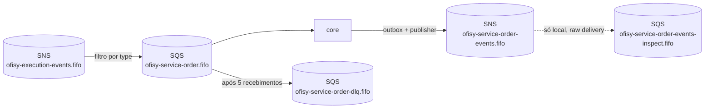
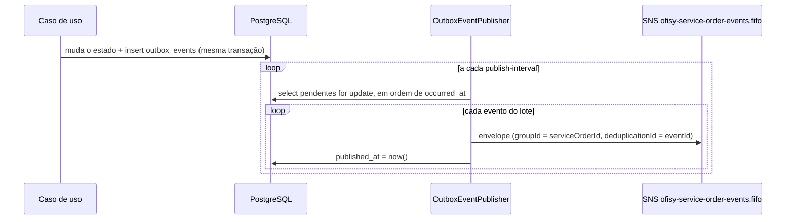

# Mensageria

O core se comunica com os microsserviços por eventos, usando **Amazon SNS + SQS** ([ADR-0011](adr/0011-utilizar-sns-e-sqs-como-mensageria.md)), com a saga coordenada por coreografia ([ADR-0012](adr/0012-coordenar-a-saga-por-coreografia.md)). Os eventos publicados pelo core saem por um *transactional outbox* para o tópico `ofisy-service-order-events.fifo`, e os eventos dos outros serviços chegam por uma única fila FIFO, `ofisy-service-order.fifo`.

A estrutura é a mesma do `ms-ofisy-execution`: mesmo envelope, mesmo outbox e mesmo despacho por `type`. Assim, um evento publicado por qualquer um dos lados tem o mesmo contrato.

---

## Topologia



| Recurso          | Nome                                      | Observação                                                                                             |
|------------------|-------------------------------------------|--------------------------------------------------------------------------------------------------------|
| Tópico           | `ofisy-service-order-events.fifo`         | Tópico do core, configurado em `ofisy.messaging.topics.service-order`                                  |
| Fila             | `ofisy-service-order.fifo`                | Configurada em `ofisy.messaging.queues.service-order`                                                  |
| DLQ              | `ofisy-service-order-dlq.fifo`            | `RedrivePolicy` com `maxReceiveCount=5`                                                                |
| Fila de inspeção | `ofisy-service-order-events-inspect.fifo` | Só local. Assinada no tópico do core para ver o que foi publicado                                      |
| Tópico assinado  | `ofisy-execution-events.fifo`             | Tópico do `ms-ofisy-execution`. A fila do core recebe só `ExecutionStarted` e `AllExecutionsCompleted` |

A fila do core assina o tópico `ofisy-execution-events.fifo`, do `ms-ofisy-execution`, com `RawMessageDelivery=true` e `FilterPolicy` por `type` no corpo da mensagem (`FilterPolicyScope=MessageBody`), recebendo só `ExecutionStarted` e `AllExecutionsCompleted`. Os eventos de outros serviços entram da mesma forma, junto com o primeiro handler de cada um.

Localmente, tudo é criado pelo `localstack/init/ready.d/01-messaging.sh`, que roda quando o LocalStack sobe (pelo `compose.yaml`, pelo `compose.db.yaml` e nos testes de integração). Com `queue-not-found-strategy: fail`, a aplicação não inicia se a fila não existir.

Na AWS, os recursos vêm do repositório de infraestrutura. O tópico é configurado pelo **nome**: o `SnsConfig` registra um `TopicsListingTopicArnResolver`, que descobre o ARN listando os tópicos (`sns:ListTopics`) em vez de chamar `CreateTopic`, e guarda o resultado em cache. A aplicação precisa de `sns:ListTopics`, `sns:Publish` e, na fila, `sqs:GetQueueUrl`, `sqs:ReceiveMessage`, `sqs:DeleteMessage` e `sqs:ChangeMessageVisibility`.

---

## Contrato dos eventos

Todo evento segue o mesmo envelope (`adapters/listeners/dto/EventEnvelope.java`). O `payload` varia conforme o `type`:

| Campo            | Tipo    | Descrição                                                   |
|------------------|---------|-------------------------------------------------------------|
| `eventId`        | UUID    | Identificador único do evento, usado para idempotência      |
| `type`           | String  | Tipo do evento, usado no filtro da assinatura e no despacho |
| `serviceOrderId` | UUID    | Ordem de serviço à qual o evento se refere                  |
| `occurredAt`     | Instant | Momento em que o evento ocorreu no produtor                 |
| `payload`        | JSON    | Dados específicos do tipo de evento                         |

```json
{
  "eventId": "5e6f7a8b-9c0d-4e1f-8a2b-3c4d5e6f7a8b",
  "type": "ServiceOrderCancelled",
  "serviceOrderId": "c3d4e5f6-a7b8-9012-cdef-123456780001",
  "occurredAt": "2026-10-20T10:00:00Z",
  "payload": {}
}
```

### Eventos consumidos

| Evento                   | Produtor             | Handler                         | Efeito                                                                                        |
|--------------------------|----------------------|---------------------------------|-----------------------------------------------------------------------------------------------|
| `ExecutionStarted`       | `ms-ofisy-execution` | `ExecutionStartedHandler`       | Move a OS de `AWAITING_EXECUTION` para `IN_PROGRESS`                                          |
| `AllExecutionsCompleted` | `ms-ofisy-execution` | `AllExecutionsCompletedHandler` | Move a OS de `IN_PROGRESS` para `FINISHED`                                                    |

Os dois eventos têm payload `{}`. O tratamento depende do status em que a OS está quando o evento chega:

- **No status esperado**: aplica a transição e registra o `eventId` em `processed_events`.
- **Já à frente do evento** (`IN_PROGRESS` ou status final para o `ExecutionStarted`; `FINISHED`, `DELIVERED` ou `CANCELLED` para o `AllExecutionsCompleted`): só registra o evento, que é confirmado sem mudar a OS.
- **`AllExecutionsCompleted` com a OS ainda em `AWAITING_EXECUTION`** (o `ExecutionStarted` se perdeu, por exemplo na DLQ): aplica as duas transições, `IN_PROGRESS` e `FINISHED`.
- **Atrás do evento** (antes de `AWAITING_EXECUTION`): a transição é inválida, a exceção impede o ack e a mensagem volta para a fila até a OS alcançar o status ou, depois de 5 recebimentos, ir para a DLQ.
- **OS inexistente**: a mensagem vai para a DLQ de propósito, porque indica inconsistência entre os serviços.

### Eventos publicados

| Evento                  | Quando é publicado                             | Quem reage                                                         |
|-------------------------|------------------------------------------------|--------------------------------------------------------------------|
| `ServiceOrderCancelled` | Ao cancelar a OS (`CancelServiceOrderService`) | `ms-ofisy-execution` cancela as execuções pendentes e em andamento |

O payload é `{}`.

---

## Consumo de eventos

O `ServiceOrderEventsListener` (`adapters/listeners/`) escuta a fila `ofisy-service-order.fifo`. Ele não conhece os eventos: recebe todos os `EventHandler` registrados no Spring e despacha pelo `type`. Cada tipo de evento tem seu próprio handler em `adapters/listeners/handlers/`.

- **Tipo sem handler**: o evento é logado como ignorado e confirmado, sem passar pelo banco.
- **Mensagem inválida ou erro no processamento**: a exceção impede o ack, a mensagem volta para a fila depois do *visibility timeout* e, depois de 5 recebimentos, vai para a DLQ.
- **Ordenação**: as mensagens chegam com `message-group-id = serviceOrderId`, então eventos de uma mesma OS são processados em ordem e OSs diferentes em paralelo.
- **Idempotência**: a entrega do SQS é *at-least-once*. O caso de uso acionado pelo handler registra o `eventId` em **`processed_events`** (`domain/messaging/ProcessedEventRepository`) na mesma transação do seu efeito e descarta o evento se o `eventId` já existir.

### Como adicionar um novo evento consumido

1. Criar o DTO do payload em `adapters/listeners/dto/`.
2. Criar um `@Component` em `adapters/listeners/handlers/` implementando `EventHandler`, com `type()` retornando o nome do evento.
3. No caso de uso acionado pelo handler, checar e gravar o `eventId` em `processed_events` na mesma transação.
4. Criar a assinatura da fila no tópico do produtor, com `RawMessageDelivery=true` e `FilterPolicy` pelo `type` (`FilterPolicyScope=MessageBody`), em `localstack/init/ready.d/01-messaging.sh` e na infraestrutura da AWS.
5. Cobrir com teste unitário do handler e, se fizer sentido, com um cenário no `ServiceOrderEventsListenerIT`.
6. Adicionar a linha na tabela de [eventos consumidos](#eventos-consumidos).

---

## Publicação de eventos (outbox)

Os casos de uso não chamam o SNS: eles gravam o evento na tabela `outbox_events`, na mesma transação da mudança de estado, e o `OutboxEventPublisher` é quem publica no tópico, de forma agendada, seguindo a [RFC-0008](rfc/0008-coordenar-a-saga-entre-os-microsservicos.md). Se a transação falhar, o evento não é gravado; se o SNS estiver fora, o evento espera no banco.



| Peça                                                    | Papel                                                                  |
|---------------------------------------------------------|------------------------------------------------------------------------|
| `domain/messaging/OutboxEvent`                          | O evento a publicar: tipo, OS e payload. Id e `occurredAt` são gerados |
| `domain/messaging/OutboxEventRepository`                | Porta usada pelos casos de uso. Só tem `save`                          |
| `adapters/gateways/messaging/OutboxEventRepositoryImpl` | Serializa o payload para JSON e grava em `outbox_events`               |
| `adapters/publishers/OutboxEventPublisher`              | Lê os pendentes, publica o envelope no SNS e marca `published_at`      |

As entidades de `outbox_events` e `processed_events` sempre inserem no `save` (`Persistable.isNew() = true`). O id vem do domínio ou do evento, então não há consulta prévia para decidir entre persist e merge, e um evento repetido viola a PK.

### Garantias

- **Ordem**: os pendentes são publicados em ordem de `occurred_at`, com `message-group-id = serviceOrderId`. Quando um evento falha, o publicador loga e **pula os eventos seguintes da mesma OS** naquele lote, para não publicá-los fora de ordem. Os eventos das outras OSs continuam sendo publicados. O evento que falhou é tentado de novo no próximo ciclo.
- **Evento que sempre falha**: um evento com falha permanente é tentado a cada ciclo e segura os eventos seguintes da sua OS, mas não bloqueia as outras OSs. Ainda não há limite de tentativas nem status de erro.
- **Mais de uma réplica**: a busca dos pendentes usa `SELECT ... FOR UPDATE`. Uma segunda réplica espera o lote da primeira terminar e já encontra os eventos marcados.
- **Duplicidade**: se a aplicação cair entre publicar e gravar `published_at`, o evento é publicado de novo. Dentro da janela de 5 minutos, a deduplicação FIFO (`deduplicationId = eventId`) descarta a cópia; depois disso, os consumidores precisam ser idempotentes pelo `eventId`.
- **Retenção**: os eventos publicados continuam na tabela, com `published_at` preenchido. Ainda não há limpeza automática.

### Configuração

| Propriedade                               | Padrão                            | Descrição                                               |
|-------------------------------------------|-----------------------------------|---------------------------------------------------------|
| `ofisy.messaging.queues.service-order`    | `ofisy-service-order.fifo`        | Fila de onde o core consome os eventos                  |
| `ofisy.messaging.topics.service-order`    | `ofisy-service-order-events.fifo` | Tópico onde os eventos do core saem                     |
| `ofisy.messaging.outbox.publish-interval` | `1s`                              | Intervalo entre o fim de um ciclo e o início do próximo |
| `ofisy.messaging.outbox.batch-size`       | `100`                             | Máximo de eventos publicados por ciclo                  |

### Como publicar um novo evento

1. Criar um `record` com o payload do evento.
2. No caso de uso, dentro da transação que muda o estado, chamar `outboxEventRepository.save(OutboxEvent.create("NomeDoEvento", serviceOrderId, payload))`.
3. Cobrir no teste do caso de uso que o evento é gravado e adicionar a linha na tabela de [eventos publicados](#eventos-publicados).

---

## Testes

Os testes de integração (`integration/IntegrationTestBase`) sobem um LocalStack via Testcontainers com o mesmo `01-messaging.sh` do compose, então a fila, a DLQ e o tópico são os mesmos do ambiente local. A espera é pelo log `Ready.`, que o LocalStack imprime depois que o init script termina.

| Teste                            | O que cobre                                                                                                                |
|----------------------------------|----------------------------------------------------------------------------------------------------------------------------|
| `OutboxEventPublisherTest`       | Envelope FIFO, ordem, `published_at` e o salto dos eventos da OS que falhou                                                |
| `ServiceOrderEventsListenerTest` | Despacho pelo `type`, tipo sem handler, falha do handler e `type` duplicado entre handlers                                 |
| `OutboxEventPublisherIT`         | Evento gravado no outbox chega na fila de inspeção e fica com `published_at`                                               |
| `ServiceOrderEventsListenerIT`   | Evento sem handler é confirmado, `ExecutionStarted` repetido move a OS uma vez só e `AllExecutionsCompleted` finaliza a OS |

---

## Exercitando o fluxo localmente

Com o LocalStack no ar (`docker compose -f compose.db.yaml up -d`):

```bash
# eventos publicados pelo core
docker exec ofisy-local-localstack awslocal sqs receive-message \
  --queue-url http://localhost:4566/000000000000/ofisy-service-order-events-inspect.fifo \
  --max-number-of-messages 10

# simular o ms-ofisy-execution publicando no tópico dele (a OS ...780007 do seed está em AWAITING_EXECUTION)
docker exec ofisy-local-localstack awslocal sns publish \
  --topic-arn arn:aws:sns:us-east-1:000000000000:ofisy-execution-events.fifo \
  --message-group-id c3d4e5f6-a7b8-9012-cdef-123456780007 \
  --message-deduplication-id $(uuidgen) \
  --message '{"eventId":"'$(uuidgen)'","type":"ExecutionStarted","serviceOrderId":"c3d4e5f6-a7b8-9012-cdef-123456780007","occurredAt":"2026-10-17T13:00:00Z","payload":{}}'
```

O log mostra `ExecutionStartedHandler.handle >> event ... handled for service order ...`, a OS vai para `IN_PROGRESS` e o `eventId` aparece em `processed_events`. Um `type` sem handler gera `ServiceOrderEventsListener.onMessage >> ignoring event ...` e a mensagem sai da fila.

> O LocalStack do core e o do `ms-ofisy-execution` usam a porta `4566`, então só um deles pode ficar no ar por vez. Para exercitar a comunicação entre os dois serviços, os dois precisam apontar para o mesmo LocalStack, com os tópicos e as assinaturas de ambos.