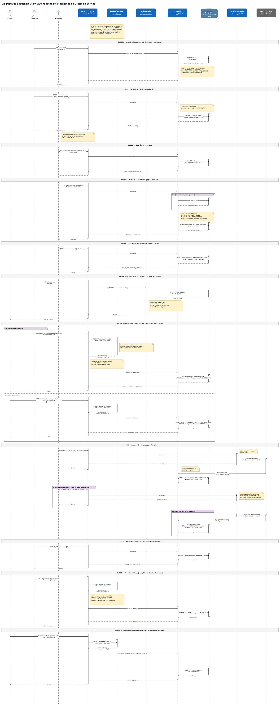

# Diagrama de Sequência - Ofisy

Diagrama de sequência que documenta o fluxo de ponta a ponta da aplicação Ofisy: desde a autenticação de cada ator até a finalização da ordem de serviço (OS).

Três atores envolvidos: **Cliente**, **Atendente** e **Mecânico**
Seis componentes de infraestrutura envolvidos: o **API Gateway**, a **Lambda de autenticação** (`techchallenge-ofisy-auth`), a **API Ofisy** (`techchallenge-ofisy`, rodando no EKS), o **PostgreSQL** (RDS, `techchallenge-ofisy-rds-infra`), o **`ms-ofisy-execution`** e o **SNS/SQS**, por onde os eventos trafegam entre os dois serviços.
O fluxo está organizado em 10 blocos sequenciais: login do Atendente, abertura da OS, diagnóstico, geração de orçamento, submissão para aprovação, autenticação do Cliente via CPF/CNPJ, **aprovação ou reprovação do orçamento pelo Cliente**, execução dos serviços no `ms-ofisy-execution`, finalização automática da OS (a Ofisy API consome `ExecutionStarted` e `AllExecutionsCompleted` e atualiza o status) e entrega do veículo.
Cada bloco indica o endpoint chamado, o componente responsável e a interação com o banco de dados.

