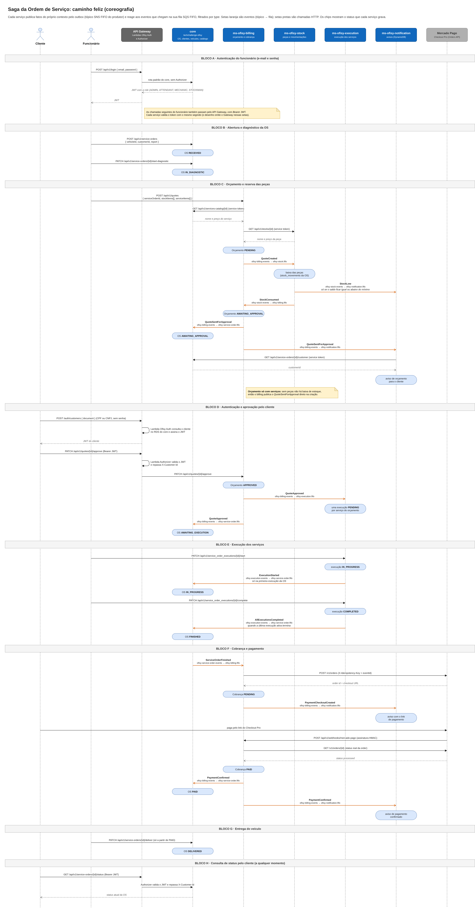
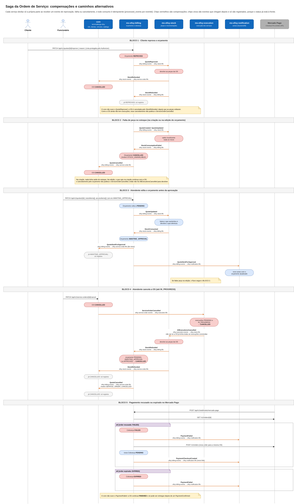

# Diagrama de Sequência - Ofisy

Diagramas de sequência da saga da ordem de serviço (OS), coordenada por coreografia entre o core e os microsserviços ([ADR-0012](adr/0012-coordenar-a-saga-por-coreografia.md)).

Participam dois atores, **Cliente** e **Funcionário** (atendente ou mecânico), o **API Gateway** com as Lambdas de autenticação, o **core** (`techchallenge-ofisy`), o **`ms-ofisy-billing`**, o **`ms-ofisy-stock`**, o **`ms-ofisy-execution`**, o **`ms-ofisy-notification`** e o **Mercado Pago**.

Setas laranja são eventos e trazem o tópico SNS do produtor e a fila SQS do consumidor. Setas pretas são chamadas HTTP. Os chips mostram o status que cada serviço grava ao processar a mensagem.

## Caminho feliz

O fluxo está organizado em 8 blocos:

| Bloco | O que acontece |
|---|---|
| A | O funcionário faz login no core e recebe o JWT com a role |
| B | O atendente abre a OS e o mecânico inicia o diagnóstico |
| C | O atendente cria o orçamento no billing, que consulta o catálogo no core e as peças no stock. O stock dá baixa nas peças (`QuoteCreated` → `StockConsumed`) e o billing envia o orçamento para aprovação (`QuoteSentForApproval`), que leva a OS a `AWAITING_APPROVAL` e gera o aviso ao cliente |
| D | O cliente se autentica por CPF/CNPJ e aprova o orçamento. O `QuoteApproved` cria as execuções e leva a OS a `AWAITING_EXECUTION` |
| E | O mecânico inicia e conclui as execuções. O `ExecutionStarted` leva a OS a `IN_PROGRESS` e o `AllExecutionsCompleted`, a `FINISHED` |
| F | O `ServiceOrderFinished` faz o billing criar a cobrança no Mercado Pago. Depois do pagamento, o webhook e o `PaymentConfirmed` levam a OS a `PAID` |
| G | O atendente entrega o veículo, o que só é permitido a partir de `PAID` |
| H | O cliente consulta o status da OS a qualquer momento |

## Compensações e caminhos alternativos

| Bloco | O que acontece |
|---|---|
| 1 | O cliente reprova o orçamento: o stock devolve as peças e o `StockRefunded` cancela a OS |
| 2 | Falta peça na criação ou na edição do orçamento: o billing cancela o orçamento e o `QuoteCancelled` cancela a OS |
| 3 | O atendente edita o orçamento antes da aprovação: o stock ajusta a diferença e o orçamento volta para aprovação |
| 4 | O atendente cancela a OS: as execuções são canceladas, o stock devolve as peças e o billing cancela o orçamento |
| 5 | O pagamento é recusado ou expira: o notification avisa o cliente e, na recusa, o billing abre uma nova cobrança |

